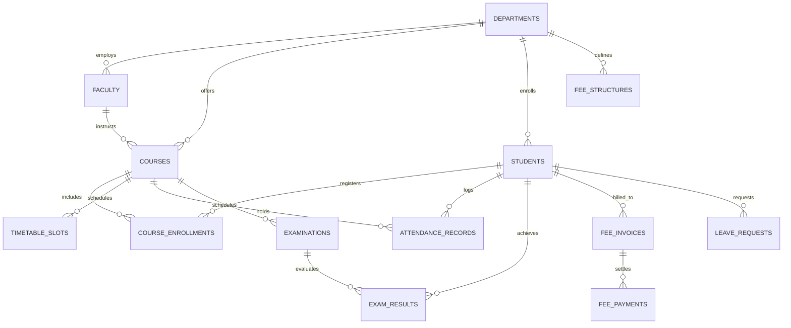

# 🏛️ Institute Management System (IMS Enterprise)

[](https://www.python.org/)
[](https://fastapi.tiangolo.com/)
[](https://www.sqlite.org/)
[](tests/)
[](https://github.com/AadityaBhuree/Institute-Management-System/actions/workflows/ci.yml)
[](Dockerfile)
[](pyproject.toml)
[](src/)

A modern, high-performance, and modular educational administration platform built with **FastAPI**, **SQLite** (WAL mode), and a responsive **Glassmorphism Web Dashboard**. Engineered for academic institutions, colleges, and university divisions to automate admissions, course scheduling, attendance registries, academic grading, bursar financial audits, lecture timetables, campus bulletins, library circulation, residential hostels, corporate placement drives, transport fleet transit logistics, scholarship grants, alumni mentorship networks, scientific laboratory equipment circulation, and student infirmary healthcare services.

---

## 📌 Executive Architecture & Highlights

* **Admissions & Scholar Registry:** Sequential institutional enrollment code generation (`IMS-YYYY-DEPT-XXXX`), full scholar profile management, department filtering, and real-time status transitions.
* **Faculty Directory & Curriculum:** Faculty instructor directory, multi-semester course catalog, credit tracking, and automated capacity-enforced student course enrollments.
* **Attendance & Examination Hub:** Daily session attendance registers (Present, Absent, Late, Excused), examination scheduling (Midterms, Finals, Quizzes), batch grade submission, and automated grading letter evaluation ($A^+, A, B, C, D, F$).
* **Bursar Invoicing & Financial Audit:** Standardized departmental fee schedules, student invoice issuance (`INV-YYYY-XXXX`), partial and full payment collection, unique receipt numbering (`REC-YYYY-XXXX`), overdue calculation, financial ledger audit, and print-ready official fee receipts.
* **Campus Bulletins & Announcements:** Institutional broadcast engine with priority tags (`HIGH`, `NORMAL`, `LOW`), target audience filtering (`ALL`, `STUDENTS`, `FACULTY`), and circular lifecycle management (`/announcements`).
* **Lecture Timetable & Conflict Sentinel:** Weekly scheduling matrix with automated classroom double-booking collision prevention and instructor schedule overlap detection (`/timetable`).
* **Institutional Leave Management:** Absence petitions, medical leaves, duty slips, and Dean review decision workflows with status telemetry (`/leaves`).
* **Campus Library & Monograph Circulation:** ISBN monograph catalog, search, real-time copy inventory, loan checkout/returns, and overdue fines (`/library`).
* **Hostel & Residential Hall Management:** Residential blocks, room types (Single/Double/Dorm), capacity-capped bed allocations, and scholar check-in/checkout tracking (`/hostel`).
* **Campus Placements & Corporate Recruitment Cell:** Partner recruitment drives, minimum GPA eligibility verification, candidate application pipeline, interview scheduling, and verified CTC package telemetry (`/placements`).
* **Campus Transport Fleet & Transit Logistics:** Multi-stop campus bus routes, fleet vehicle allocation, driver logs, route stops, and sequential student transit passes (`PASS-YYYY-XXXX`) (`/transport`).
* **Scholarships, Grants & Financial Aid:** Institutional and endowment schemes, automated GPA and family income eligibility gating, bursar review decisions, and grant disbursement tracking (`/scholarships`).
* **Alumni Network & Career Mentorship:** Graduate directory, cohort filtering, industry roles, student mentorship requests, and career guidance session tracking (`/alumni`).
* **Campus Events & Symposiums Hub:** Institutional conferences, workshops, technical hackathons, guest lectures, scholar registrations with capacity enforcement, attendee tracking, and digital verifiable certificate issuance (`/events`).
* **Campus Assets & Lab Equipment Hub:** Scientific lab instruments, computing clusters, circulation loans, return condition inspection, and maintenance work orders (`/inventory`).
* **Campus Health & Infirmary Hub:** Electronic consultation encounters, vital signs, emergency contacts, blood group/allergy registry, dispensary pharmacy stock, and verifiable medical certificates (`/health-center`).
* **Student & Faculty Portals:** Scholar self-service academic dossier (`/portal`), faculty teaching workbench (`/faculty-portal`), institutional reports & `< 75%` attendance risk sentinel (`/reports`), and official printable transcripts.
* **Institutional Reports & CSV Data Engine:** Real-time attendance risk sentinel (< 75%), grade distributions, fiscal recovery audits, and streaming CSV downloads for scholar directories, attendance telemetry, and financial audit ledgers.
* **Sleek Enterprise UX:** Vanilla CSS glassmorphic theme (`#090d16` & `#0f172a`), interactive modals, responsive sidebar, toast notifications, and KPI overview cards.

---

## 🏗️ System Architecture & Entity Relationships



---

## 📁 Repository Directory Structure

```
Institute Management System/
├── data/
│   ├── backups/                    # Hot online SQLite point-in-time database backups
│   └── ims.db                      # SQLite database in WAL mode with foreign keys
├── scripts/
│   └── seed_demo_data.py           # Idempotent realistic demonstration dataset seeder
├── src/
│   ├── api/                        # Modular FastAPI REST API route handlers
│   │   ├── academics.py            # Attendance and examination endpoints
│   │   ├── alumni.py               # Alumni directory and career mentorship endpoints
│   │   ├── announcements.py        # Campus bulletin and announcements endpoints
│   │   ├── courses.py              # Course catalog and enrollment endpoints
│   │   ├── events.py               # Campus events, symposiums, and registration endpoints
│   │   ├── faculty.py              # Faculty directory endpoints
│   │   ├── finance.py              # Invoicing, receipts, and audit endpoints
│   │   ├── health_center.py        # Clinical encounters, dispensary, and medical certificates
│   │   ├── hostel.py               # Residential halls and bed allocation endpoints
│   │   ├── inventory.py            # Laboratory equipment and asset circulation endpoints
│   │   ├── leaves.py               # Leave application and approval endpoints
│   │   ├── library.py              # Campus library and loan circulation endpoints
│   │   ├── placements.py           # Corporate recruitment and hiring drive endpoints
│   │   ├── reports.py              # Institutional analytics and telemetry endpoints
│   │   ├── scholarships.py         # Scholarship schemes and aid grant endpoints
│   │   ├── students.py             # Admissions and scholar endpoints
│   │   ├── timetable.py            # Lecture timetable and scheduling endpoints
│   │   └── transport.py            # Fleet routes, vehicles, and transit pass endpoints
│   ├── core/
│   │   └── config.py               # Application configuration and path tokens
│   ├── database/
│   │   ├── connection.py           # SQLite connection pool and atomic transaction contexts
│   │   ├── init_db.py              # Schema deployment and seed verification
│   │   └── schema.sql              # Relational DDL schema with 28 tables & 46 indexes
│   ├── models/                     # Strongly-typed Pydantic schemas (v2)
│   │   ├── academics.py            # Attendance and exam request/response schemas
│   │   ├── alumni.py               # Alumni member and mentorship schemas
│   │   ├── announcement.py         # Campus bulletin schemas
│   │   ├── asset.py                # Asset, checkout, and maintenance schemas
│   │   ├── course.py               # Course and enrollment schemas
│   │   ├── department.py           # Department schemas
│   │   ├── event.py                # Event and attendee registration schemas
│   │   ├── faculty.py              # Faculty schemas
│   │   ├── finance.py              # Fee structure, invoice, and payment schemas
│   │   ├── health.py               # Health profile, encounter, and dispensary schemas
│   │   ├── hostel.py               # Residential block and allocation schemas
│   │   ├── leave.py                # Leave petition and review schemas
│   │   ├── library.py              # Library book and loan schemas
│   │   ├── placement.py            # Placement drive and candidate schemas
│   │   ├── scholarship.py          # Scholarship scheme and application schemas
│   │   ├── student.py              # Admissions and scholar registry schemas
│   │   ├── timetable.py            # Timetable slot schemas
│   │   └── transport.py            # Fleet route, vehicle, and pass schemas
│   ├── services/                   # Business logic and database operations
│   │   ├── academics_service.py    # Attendance and exam evaluation logic
│   │   ├── alumni_service.py       # Alumni directory and mentorship matchmaking logic
│   │   ├── announcement_service.py # Bulletin CRUD and priority query logic
│   │   ├── asset_service.py        # Asset circulation, loans, and repair orders
│   │   ├── course_service.py       # Course scheduling and capacity enforcement
│   │   ├── dashboard_service.py    # Executive KPI metric aggregations
│   │   ├── department_service.py   # Department operations
│   │   ├── event_service.py        # Event management and attendee capacity logic
│   │   ├── faculty_service.py      # Faculty management & teaching workbench
│   │   ├── finance_service.py      # Invoicing, receipts, and ledger audit
│   │   ├── health_service.py       # Clinical consultations, dispensary, and certificates
│   │   ├── hostel_service.py       # Residential hall and room allocation logic
│   │   ├── leave_service.py        # Absence petitions and approval workflows
│   │   ├── library_service.py      # Book circulation and loan inventory logic
│   │   ├── placement_service.py    # Placement drives and candidate pipeline logic
│   │   ├── reports_service.py      # Institutional telemetry and risk sentinels
│   │   ├── scholarship_service.py  # Scholarship scheme and eligibility gating logic
│   │   ├── student_service.py      # Student registry and admission routines
│   │   ├── system_service.py       # Telemetry and hot SQLite online backup engine
│   │   ├── timetable_service.py    # Timetable matrix and collision avoidance logic
│   │   └── transport_service.py    # Fleet route, vehicle, and transit pass logic
│   └── app.py                      # FastAPI application, static mounting, and page routes
│   └── ...
├── templates/                      # Jinja2 SSR Templates
│   ├── academics.html              # Attendance register and exam grading hub
│   ├── alumni.html                 # Alumni network and career mentorship hub
│   ├── announcements.html          # Campus bulletin board and notice broadcast hub
│   ├── base.html                   # Global glassmorphic sidebar layout
│   ├── courses.html                # Course catalog and faculty roster portal
│   ├── dashboard.html              # Executive overview dashboard
│   ├── events.html                 # Campus events and symposiums hub
│   ├── faculty_portal.html         # Faculty instructor workbench
│   ├── finance.html                # Invoicing, payment collection, and audit ledger
│   ├── health_center.html          # Campus clinic, dispensary, and infirmary hub
│   ├── hostel.html                 # Hostel and residential hall housing portal
│   ├── inventory.html              # Campus assets and laboratory equipment hub
│   ├── leaves.html                 # Leave management and absence approval portal
│   ├── library.html                # Campus library catalog and loan circulation
│   ├── placements.html             # Corporate placements and recruitment cell
│   ├── portal.html                 # Student self-service scholar portal
│   ├── print_receipt.html          # Printable official fee receipt with seal
│   ├── print_transcript.html       # Printable academic transcript dossier
│   ├── reports.html                # Institutional analytics and attendance sentinel
│   ├── scholarships.html           # Scholarships and financial aid grant portal
│   ├── settings.html               # System telemetry and hot online database backups
│   ├── students.html               # Admissions and student registry directory
│   ├── timetable.html              # Weekly academic lecture timetable matrix
│   └── transport.html              # Campus transport fleet and transit pass hub
├── tests/                          # Automated Pytest validation suite (162 tests)
│   ├── conftest.py                 # Isolated test database runner
│   ├── test_academics_api.py       # Attendance and examination API test cases
│   ├── test_alumni_api.py          # Alumni network and mentorship test cases
│   ├── test_announcements_api.py   # Bulletin board API and web test cases
│   ├── test_core_and_dashboard.py  # Health check, settings, and backup test cases
│   ├── test_courses_and_faculty.py # Course catalog and faculty test cases
│   ├── test_events_api.py          # Campus events and attendee test cases
│   ├── test_finance_api.py         # Invoices, receipts, and printable receipt tests
│   ├── test_health_center_api.py   # Clinic encounters, dispensary, and cert tests
│   ├── test_hostel_api.py          # Hostel blocks and bed allocation test cases
│   ├── test_inventory_api.py       # Campus assets and lab equipment test cases
│   ├── test_leaves_api.py          # Leave application and approval test cases
│   ├── test_library_api.py         # Library monographs and loan test cases
│   ├── test_placements_api.py      # Campus placements and hiring drive test cases
│   ├── test_reports_export_api.py  # CSV export streaming and data engine tests
│   ├── test_scholarships_api.py    # Scholarships and grant disbursement tests
│   ├── test_students_api.py        # Admissions, scholar portal, and transcript tests
│   ├── test_timetable_api.py       # Timetable scheduling and collision test cases
│   └── test_transport_api.py       # Transport fleet and transit pass test cases
├── Dockerfile                      # Multi-stage production container
├── docker-compose.yml              # Persistent volume container deployment
├── render.yaml                     # Infrastructure-as-code cloud blueprint
├── pyproject.toml                  # Project metadata, Ruff rules, and Pytest configuration
├── requirements.txt                # Production dependencies
└── README.md                       # Architectural documentation
```

---

## 🔌 Complete RESTful API Reference

### 🎓 Admissions & Students
| Method | Endpoint | Description |
|---|---|---|
| `POST` | `/api/students` | Enroll a new student and issue sequential enrollment ID |
| `GET` | `/api/students` | List students with department, semester, and text filters |
| `GET` | `/api/students/{id}` | Retrieve individual student demographic profile |
| `PUT` | `/api/students/{id}` | Update scholar contact, address, or academic semester |
| `DELETE` | `/api/students/{id}` | Soft-delete / withdraw student registration |
| `GET` | `/api/students/stats/summary` | Academic enrollment metrics and semester breakdown |

### 📚 Faculty & Course Catalog
| Method | Endpoint | Description |
|---|---|---|
| `POST` | `/api/faculty` | Add faculty member with unique institutional faculty ID |
| `GET` | `/api/faculty` | List faculty roster filtered by department or status |
| `GET` | `/api/faculty/{id}` | Retrieve faculty instructor dossier |
| `POST` | `/api/courses` | Create an academic course with credits and seat capacity |
| `GET` | `/api/courses` | List course catalog with active enrollment counts |
| `POST` | `/api/courses/enroll` | Enroll student into course with capacity checking |
| `GET` | `/api/courses/{id}/students`| List all enrolled students for a specific course |

### 📝 Attendance & Examinations
| Method | Endpoint | Description |
|---|---|---|
| `POST` | `/api/academics/attendance/mark` | Batch mark daily session attendance (PRESENT/ABSENT/LATE) |
| `GET` | `/api/academics/attendance` | Retrieve session attendance roster for a course & date |
| `GET` | `/api/academics/attendance/student/{id}/summary` | Scholar attendance percentage and low-attendance alert |
| `POST` | `/api/academics/exams` | Schedule examination with weightage and passing marks |
| `GET` | `/api/academics/exams` | List scheduled examinations and grading statuses |
| `POST` | `/api/academics/exams/{id}/grades` | Batch submit student exam scores and calculate letter grades |
| `GET` | `/api/academics/exams/{id}/results` | Retrieve graded evaluation dossier and statistics |

### 💳 Fee Invoicing & Financial Audit
| Method | Endpoint | Description |
|---|---|---|
| `POST` | `/api/finance/fee-structures` | Configure standardized departmental semester fee schedule |
| `GET` | `/api/finance/fee-structures` | List departmental fee schedules |
| `POST` | `/api/finance/invoices` | Issue student fee invoice with unique number (`INV-2026-XXXX`) |
| `GET` | `/api/finance/invoices` | List fee invoices filtered by status, department, and search |
| `GET` | `/api/finance/invoices/{id}` | Get detailed invoice with historical payment receipts |
| `POST` | `/api/finance/payments` | Record fee payment, update balance, and issue receipt (`REC-XXXX`)|
| `GET` | `/api/finance/payments` | Query the real-time bursar payment audit ledger |
| `GET` | `/api/finance/summary` | Executive financial summary (billed, collected, collection rate) |

### 📢 Campus Notice Board & Announcements
| Method | Endpoint | Description |
|---|---|---|
| `POST` | `/api/announcements` | Post institutional notice with priority tags & audience |
| `GET` | `/api/announcements` | Query campus notices filtered by audience, category, status |
| `GET` | `/api/announcements/{id}` | Retrieve individual announcement notice |
| `PUT` | `/api/announcements/{id}/toggle-active` | Archive or publish bulletin notice |
| `DELETE` | `/api/announcements/{id}` | Remove announcement from bulletin board |

### 🗓️ Lecture Timetable & Scheduling
| Method | Endpoint | Description |
|---|---|---|
| `POST` | `/api/timetable` | Schedule lecture slot with room & instructor collision avoidance |
| `GET` | `/api/timetable` | Query scheduled lecture slots with room & course metadata |
| `GET` | `/api/timetable/matrix` | Weekly schedule matrix organized Monday through Saturday |
| `GET` | `/api/timetable/{id}` | Retrieve individual timetable slot |
| `DELETE` | `/api/timetable/{id}` | Remove lecture slot from timetable |

### 📋 Leave Management & Absence Petitions
| Method | Endpoint | Description |
|---|---|---|
| `POST` | `/api/leaves` | Submit student or faculty absence/leave petition |
| `GET` | `/api/leaves` | List leave requests filtered by role, status, applicant ID |
| `GET` | `/api/leaves/stats/summary` | Aggregate leave metrics (Pending, Approved, Rejected) |
| `GET` | `/api/leaves/{id}` | Retrieve individual leave petition dossier |
| `PUT` | `/api/leaves/{id}/status` | Review and approve/reject leave petition with remarks |

### 📖 Campus Library & Digital Monograph Circulation
| Method | Endpoint | Description |
|---|---|---|
| `POST` | `/api/library/books` | Catalog a new monograph volume with ISBN, shelf, and copies |
| `GET` | `/api/library/books` | List books filtered by category, shelf, or title/author search |
| `GET` | `/api/library/loans` | Query scholar book loan circulation registers |
| `POST` | `/api/library/loans/issue` | Checkout monograph book to scholar with due date tracking |
| `PUT` | `/api/library/loans/{id}/return` | Check in returned book, update inventory, and record fines |
| `GET` | `/api/library/stats` | Circulation telemetry (copies, active loans, overdue fines) |

### 🏠 Residential Halls & Bed Allocations
| Method | Endpoint | Description |
|---|---|---|
| `POST` | `/api/hostel/blocks` | Register residential hall block with warden contact |
| `GET` | `/api/hostel/blocks` | List hostel hall blocks and residential directories |
| `POST` | `/api/hostel/rooms` | Configure residential rooms with capacity, floor, and fee |
| `GET` | `/api/hostel/rooms` | Query room occupancy, room types, and capacity status |
| `POST` | `/api/hostel/allocate` | Allocate bed to scholar with academic year and check-in date |
| `PUT` | `/api/hostel/allocations/{id}/checkout` | Checkout scholar and decrement active room occupancy |
| `GET` | `/api/hostel/stats` | Residential telemetry (occupancy rate, capacity, bed count) |

### 💼 Campus Placements & Corporate Recruitment
| Method | Endpoint | Description |
|---|---|---|
| `POST` | `/api/placements/drives` | Host corporate recruitment drive with CTC package & min GPA |
| `GET` | `/api/placements/drives` | List recruitment drives with applicant counts and filters |
| `POST` | `/api/placements/apply` | Submit student application with automated GPA gating |
| `GET` | `/api/placements/applications` | Query candidate applications, interviews, and offer packages |
| `PUT` | `/api/placements/applications/{id}/status` | Advance pipeline stage (Shortlisted, Tech Round, Selected) |
| `GET` | `/api/placements/stats` | Placement telemetry (hiring partners, offers, avg/highest CTC) |

### 🚌 Campus Transport Fleet & Transit Logistics
| Method | Endpoint | Description |
|---|---|---|
| `POST` | `/api/transport/routes` | Define bus transit route with stops and semester fare |
| `GET` | `/api/transport/routes` | List transport routes with vehicle and pass counts |
| `POST` | `/api/transport/vehicles` | Register fleet vehicle and assign driver & route |
| `GET` | `/api/transport/vehicles` | List fleet vehicles filtered by route and operational status |
| `POST` | `/api/transport/passes` | Issue student transit pass (`PASS-YYYY-XXXX`) |
| `GET` | `/api/transport/passes` | Query transit passes with student and route metadata |
| `PUT` | `/api/transport/passes/{id}/cancel` | Cancel transit pass and free vehicle seat allocation |
| `GET` | `/api/transport/stats` | Fleet telemetry (vehicles, routes, active passes, capacity) |

### 🎓 Scholarships, Grants & Financial Aid
| Method | Endpoint | Description |
|---|---|---|
| `POST` | `/api/scholarships/schemes` | Create scholarship scheme with award amount & criteria |
| `GET` | `/api/scholarships/schemes` | List scholarship schemes and applicant counts |
| `POST` | `/api/scholarships/apply` | Submit student grant application with GPA & income gating |
| `GET` | `/api/scholarships/applications` | Query applications filtered by scheme and review status |
| `PUT` | `/api/scholarships/applications/{id}/review`| Bursar decision workflow (Approved, Disbursed, Rejected) |
| `GET` | `/api/scholarships/stats` | Financial aid telemetry (funds disbursed, scholars assisted)|

### 🤝 Alumni Network & Career Mentorship Hub
| Method | Endpoint | Description |
|---|---|---|
| `POST` | `/api/alumni/members` | Register graduate alumnus in network directory |
| `GET` | `/api/alumni/members` | List alumni filtered by batch, department, or company |
| `POST` | `/api/alumni/mentorship/request`| Scholar submits mentorship request to alumnus |
| `GET` | `/api/alumni/mentorship/requests`| Query mentorship sessions and guidance requests |
| `PUT` | `/api/alumni/mentorship/requests/{id}/status`| Update request status (Accepted, Completed, Declined) |
| `GET` | `/api/alumni/stats` | Network telemetry (active alumni, mentors, batches) |

### 🎪 Campus Events & Symposiums
| Method | Endpoint | Description |
|---|---|---|
| `POST` | `/api/events` | Schedule a new institutional event, conference, or symposium |
| `GET` | `/api/events` | List events with category, status, and department filtering |
| `GET` | `/api/events/{id}` | Retrieve individual event details and capacity telemetry |
| `PUT` | `/api/events/{id}/status` | Transition event status (UPCOMING, ACTIVE, COMPLETED, CANCELLED) |
| `POST` | `/api/events/register` | Register student attendee with capacity validation |
| `GET` | `/api/events/{id}/registrations` | List attendee registrations for a specific event |
| `PUT` | `/api/events/registrations/{id}/status`| Update attendance status and issue verifiable certificate |
| `GET` | `/api/events/stats` | Event telemetry (total, upcoming, registrations, certs) |

### 🔬 Campus Assets, Lab Equipment & Inventory Hub
| Method | Endpoint | Description |
|---|---|---|
| `POST` | `/api/inventory/assets` | Register lab instrument or equipment with sequential tag (`AST-DEPT-YYYY-XXXX`) |
| `GET` | `/api/inventory/assets` | List campus equipment with category, room, and status filters |
| `GET` | `/api/inventory/assets/{id}` | Retrieve individual asset equipment dossier |
| `PUT` | `/api/inventory/assets/{id}` | Update equipment room, status, or warranty |
| `POST` | `/api/inventory/checkouts` | Issue equipment loan checkout to scholar or faculty |
| `PUT` | `/api/inventory/checkouts/{id}/return` | Check in returned equipment with condition grading (Auto-triggers repair if damaged) |
| `POST` | `/api/inventory/maintenance` | Issue scheduled maintenance or calibration work order (`MNT-YYYY-XXXX`) |
| `PUT` | `/api/inventory/maintenance/{id}/status`| Update maintenance stage (IN_PROGRESS, COMPLETED) |
| `GET` | `/api/inventory/assets/stats` | Inventory telemetry (total assets, checked out, maintenance, valuation) |

### 🏥 Campus Health, Student Clinic & Infirmary Hub
| Method | Endpoint | Description |
|---|---|---|
| `POST` | `/api/health-center/profiles` | Register or update student/faculty health profile with blood group & allergies |
| `GET` | `/api/health-center/profiles` | List health profiles with blood group, allergy, and search filters |
| `GET` | `/api/health-center/profiles/{type}/{id}` | Retrieve individual medical profile by student or faculty ID |
| `POST` | `/api/health-center/medicines` | Catalog dispensary medicine batch with reorder thresholds (`MED-STK-XXXX`) |
| `GET` | `/api/health-center/medicines` | List dispensary medicines with low-stock warning indicators |
| `PUT` | `/api/health-center/medicines/{id}/stock` | Restock or adjust dispensary medicine inventory |
| `POST` | `/api/health-center/encounters` | Log clinical consultation encounter, record vital signs, and dispense prescriptions |
| `GET` | `/api/health-center/encounters` | Query medical encounter records with triage severity and patient type filters |
| `GET` | `/api/health-center/encounters/{id}` | Retrieve encounter dossier with vital signs and prescription items |
| `POST` | `/api/health-center/certificates` | Issue verifiable medical sick leave certificate (`MED-YYYY-XXXX`) |
| `GET` | `/api/health-center/certificates` | Query issued medical sick leave certificates |
| `PUT` | `/api/health-center/certificates/{id}/revoke`| Revoke active medical certificate |
| `GET` | `/api/health-center/stats` | Clinic health telemetry (encounters, sick leaves, low stock alerts) |

### 📊 Institutional Reports & CSV Exports
| Method | Endpoint | Description |
|---|---|---|
| `GET` | `/api/reports/analytics-summary` | Institutional telemetry, attendance risk sentinel, and recovery metrics |
| `GET` | `/api/reports/export/students/csv` | Download complete registered student directory as CSV |
| `GET` | `/api/reports/export/attendance-risk/csv` | Download at-risk (< 75%) scholar attendance report as CSV |
| `GET` | `/api/reports/export/finances/csv` | Download bursar invoice ledger audit as CSV |

---

## 🚀 Quickstart & Installation

### 1. Prerequisites
* Python 3.10+ installed

### 2. Setup Virtual Environment
```bash
python -m venv .venv

# On Windows PowerShell:
.venv\Scripts\Activate.ps1

# On macOS/Linux:
source .venv/bin/activate
```

### 3. Install Dependencies
```bash
pip install -r requirements.txt
```

### 4. Seed Realistic Demonstration Data
```bash
python scripts/seed_demo_data.py
```

### 5. Launch Application Server (Local)
```bash
python -m uvicorn src.app:app --reload --port 8000
```

### 6. Run with Docker / Container (Production)
```bash
# 1-Click Launch with Docker Compose (mounts ./data with persistent SQLite WAL storage)
docker compose up -d

# Or build and run standalone container
docker build -t ims-enterprise .
docker run -d -p 8000:8000 -v $(pwd)/data:/app/data --name ims_app ims-enterprise
```

Open **[http://localhost:8000](http://localhost:8000)** in your browser:
* **Overview Dashboard:** `http://localhost:8000/`
* **Student Registry:** `http://localhost:8000/students`
* **Scholar Self-Service Portal:** `http://localhost:8000/portal`
* **Faculty Instructor Workbench:** `http://localhost:8000/faculty-portal`
* **Courses & Faculty Catalog:** `http://localhost:8000/courses`
* **Attendance & Exams Hub:** `http://localhost:8000/academics`
* **Lecture Timetable Matrix:** `http://localhost:8000/timetable`
* **Campus Bulletins & Notices:** `http://localhost:8000/announcements`
* **Leave Management Portal:** `http://localhost:8000/leaves`
* **Campus Library Catalog:** `http://localhost:8000/library`
* **Hostel & Housing:** `http://localhost:8000/hostel`
* **Corporate Placements:** `http://localhost:8000/placements`
* **Campus Transport Fleet:** `http://localhost:8000/transport`
* **Scholarships & Financial Aid:** `http://localhost:8000/scholarships`
* **Alumni Mentorship Network:** `http://localhost:8000/alumni`
* **Campus Events & Symposiums:** `http://localhost:8000/events`
* **Assets & Lab Equipment:** `http://localhost:8000/inventory`
* **Campus Clinic & Infirmary:** `http://localhost:8000/health-center`
* **Fee Invoicing & Bursar Audit:** `http://localhost:8000/finance`
* **Institutional Reports & Sentinel:** `http://localhost:8000/reports`
* **System Settings & Hot Backup:** `http://localhost:8000/settings`
* **Health Endpoint:** `http://localhost:8000/api/health`
* **Interactive OpenAPI Docs:** `http://localhost:8000/docs`

---

## 🧪 Testing & Verification

The test suite runs with isolated SQLite databases in temporary environments via pytest fixtures:

```bash
# Run all 162 automated unit and integration tests
pytest tests/ -v

# Run Ruff linter to confirm clean code hygiene
ruff check src/ tests/ scripts/
```

---

## 📄 License
This project is licensed under the [MIT License](LICENSE).
